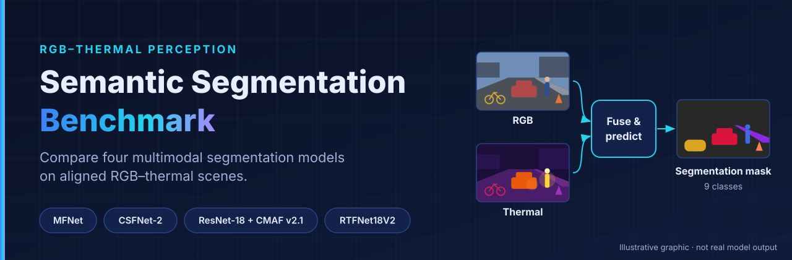
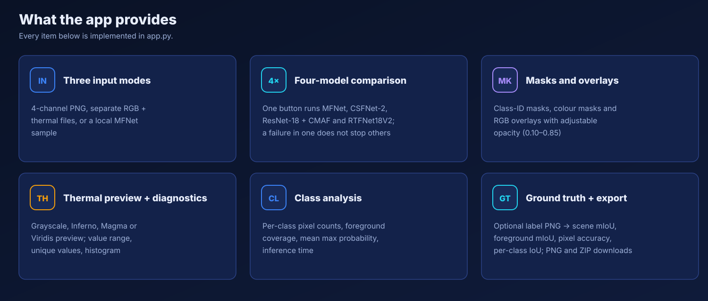
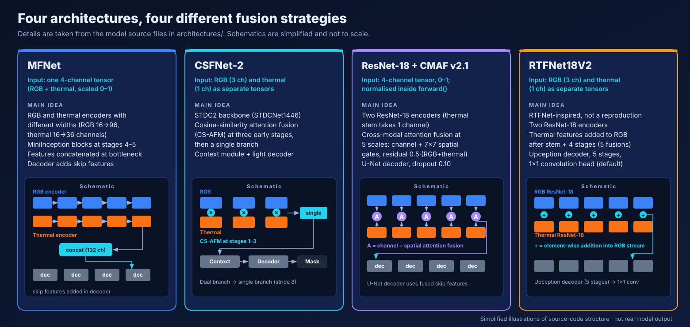
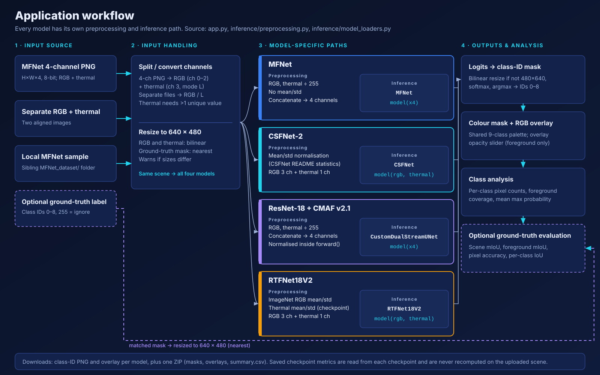
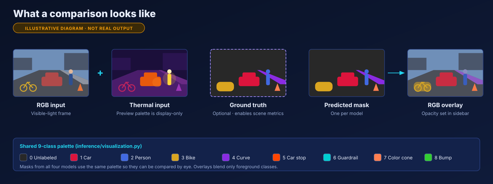
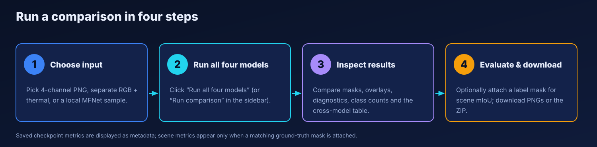
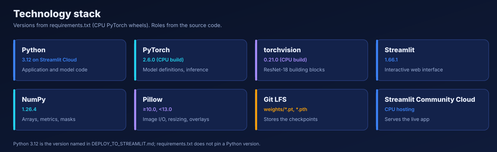

<div align="center">



# RGB–Thermal Four-Architecture Comparison App

**Run MFNet, CSFNet-2, ResNet-18 + CMAF v2.1 and RTFNet18V2 on the same aligned RGB–thermal scene and compare their segmentation masks side by side.**

<br>

<a href="https://rgb-thermal.streamlit.app/"></a>

<a href="https://github.com/Pankaj-Jhajhria/RGBT_4Architecture_Comparison_App"></a>
<a href="#installation"></a>
<a href="#models"></a>

<br>


<br><br>

[Overview](#overview) &nbsp;|&nbsp; [Features](#features) &nbsp;|&nbsp; [Models](#models) &nbsp;|&nbsp; [Architecture](#architecture) &nbsp;|&nbsp; [Demo](#live-demo) &nbsp;|&nbsp; [Metrics](#metrics-and-results) &nbsp;|&nbsp; [Installation](#installation) &nbsp;|&nbsp; [Usage](#usage)

</div>

---

## Overview

The app takes **one RGB image and its aligned thermal image**, runs them through four separately trained segmentation networks, and shows each network's nine-class prediction as a colour mask and an RGB overlay. It is built with Python, PyTorch and Streamlit and is intended for inspecting how different RGB–thermal fusion designs behave on the **same scene**.

**Why this project?** Thermal cameras see heat rather than light, so they can reveal people and vehicles that are hard to see in an RGB frame at night or in glare, while RGB keeps colour and fine texture. Fusion architectures combine the two in very different ways (concatenation, similarity-based attention, learned attention gates, element-wise addition). Seeing four of them react to identical input makes those design differences concrete.

**What the app does and does not measure**

- It shows predictions, class coverage, timing and a mean maximum softmax probability (a confidence summary, not accuracy).
- It shows **saved validation metrics** that were recorded inside each checkpoint during training. These describe the original validation run, not your upload.
- It computes **scene metrics** (mIoU, foreground mIoU, pixel accuracy, per-class IoU) only when you attach a matching ground-truth label image.
- It is not a benchmark leaderboard: it does not rank the models, and saved metrics from separate runs are not guaranteed to be comparable.

## Features



- **Three input modes:** MFNet four-channel PNG, separate RGB + thermal files, or a local MFNet sample.
- **Four-model comparison** in one click. Each model runs independently, so a failure in one panel does not stop the others.
- **Predicted masks and RGB overlays** using one shared nine-class palette, with an adjustable overlay opacity (0.10–0.85).
- **Thermal preview** with a selectable palette (Grayscale, Inferno, Magma, Viridis). The palette changes the display only, never the model input.
- **Input diagnostics:** image sizes, thermal value range, number of unique thermal values and a thermal histogram.
- **Per-class pixel counts**, foreground coverage, unique predicted classes, inference time per model and a cross-model summary table.
- **Optional ground-truth evaluation** and **downloads:** class-ID mask and overlay per model, plus one ZIP with masks, overlays and a `summary.csv`.
- **Checkpoint status panel** in the sidebar and a CPU/CUDA device selector (CUDA appears only if PyTorch detects a GPU).

## Models

| Model | Input to the network | Main idea (from the source code) |
| --- | --- | --- |
| **MFNet** | One 4-channel tensor, values scaled to 0–1 | Separate RGB and thermal encoders with MiniInception blocks; features are concatenated at the bottleneck and a decoder adds skip features. |
| **CSFNet-2** | RGB (3 ch) and thermal (1 ch) as separate tensors | STDC2 backbone (`STDCNet1446`); cosine-similarity attention fusion (CS-AFM) in the early stages, then a single branch with a context module and a lightweight decoder. |
| **ResNet-18 + CMAF v2.1** | One 4-channel tensor, 0–1; normalised inside `forward()` | Two ResNet-18 encoders; cross-modal attention fusion at five scales (channel and 7×7 spatial gates with a residual path); U-Net decoder. |
| **RTFNet18V2** | RGB (3 ch) and thermal (1 ch) as separate tensors | RTFNet-inspired dual ResNet-18; thermal features are added to the RGB stream after the stem and four stages; five-stage "Upception" decoder. |



**Implementation notes**

- **RTFNet18V2 is RTFNet-inspired, not a reproduction.** Its source states that it uses ResNet-18 encoders and does not reproduce any published RTFNet benchmark.
- **CMAF v2.1** is selected by `architecture_id`. The loader refuses a checkpoint whose architecture ID does not match, and falls back to the older scratch CMAF baseline only if no v2.1 checkpoint is found. The sidebar shows which variant is active.
- The loaders build every network with `pretrained=False` and then load the saved weights with `strict=True`, so no ImageNet weights are downloaded at inference time.

## Architecture



1. **Input.** One of three sources is read. A four-channel image is split into RGB (channels 0–2) and thermal (channel 3).
2. **Input handling.** RGB and thermal are resized to **640 × 480** with bilinear interpolation. If their sizes differ the app warns you.
3. **Model-specific preprocessing** (`inference/preprocessing.py`). This is **not identical** across models:
   - MFNet and CMAF v2.1: values divided by 255, no mean/std; the two are concatenated into four channels. CMAF v2.1 normalises inside its own `forward()`.
   - CSFNet-2: mean/std normalisation using statistics from the CSFNet README; RGB and thermal passed separately.
   - RTFNet18V2: ImageNet mean/std for RGB, thermal mean/std read from the checkpoint (fallback 0.5 / 0.25); passed separately.
4. **Inference.** Each model is loaded by its own function in `inference/model_loaders.py` and called with its own signature.
5. **Post-processing.** Logits are resized if needed, passed through softmax, and `argmax` gives the class-ID mask (0–8).
6. **Visualisation and analysis.** Colour masks, foreground-only RGB overlays, class pixel counts, confidence summary, downloads.
7. **Optional evaluation.** A ground-truth mask is resized to 640 × 480 with nearest-neighbour and compared with each prediction.

## Live Demo

<p align="center">
  <a href="https://rgb-thermal.streamlit.app/"></a>
</p>

The hosted app runs on CPU and is available at <https://rgb-thermal.streamlit.app/>. Free hosting can put the app to sleep or limit memory, so the first load and the first inference can be slow.

**Gallery.** Real screenshots of the running app have not been added yet, so the images below are **illustrative diagrams, not real application output or real predictions.** See [`docs/CAPTURE_SCREENSHOTS.md`](docs/CAPTURE_SCREENSHOTS.md) for a short guide to adding genuine screenshots.





## Metrics and results

Two kinds of numbers appear in the app and they must not be confused.

| | Saved checkpoint metrics | Scene metrics |
| --- | --- | --- |
| **Where from** | Metadata stored inside each checkpoint at training time | Computed live from your prediction and your ground-truth mask |
| **Describes** | The original validation run | Only the one scene you uploaded |
| **Needs** | Nothing | An aligned label image (class IDs 0–8, 255 = ignore) |

**Definitions used by the app** (`_segmentation_metrics` in `app.py`):

- **IoU** per class = TP / (TP + FP + FN), computed from a confusion matrix over valid pixels (ground-truth IDs 0–8; 255 is ignored).
- **mIoU** = mean IoU over classes that occur in the prediction or the label (all nine classes, including *Unlabeled*).
- **Foreground mIoU** = the same mean without class 0 (*Unlabeled*).
- **Pixel accuracy** = correctly labelled valid pixels ÷ all valid pixels.

**Verified from repository documentation:** `README_CMAF_PATH_FIX.md` records the CMAF v2.1 checkpoint as architecture `resnet18_dual_stream_cross_modal_attention_v2_1`, best epoch 22, validation mIoU 0.555502 (55.55%), 345 tensors in the state dictionary.

The other saved values (foreground mIoU, pixel accuracy, and the metrics of the other three checkpoints) are read from the checkpoint files at runtime and shown in each model panel. They are not copied here because the checkpoints are Git LFS objects that this documentation pass could not open. The evaluation split and protocol are not recorded in the repository, so **do not compare these saved numbers across models as if they came from one protocol.** The app deliberately does not rank the models.

## Installation

> **Quick start.** Windows PowerShell commands first; Linux/macOS alternative below.

The four checkpoints in `weights/` are tracked with **Git LFS** (`weights/*.pt`, `weights/*.pth`, about 0.65 GiB in total according to `DEPLOY_TO_STREAMLIT.md`). Install Git LFS before cloning, or run `git lfs pull` afterwards. Without the real files the app reports a checkpoint as missing.

```powershell
git lfs install
git clone https://github.com/Pankaj-Jhajhria/RGBT_4Architecture_Comparison_App.git
cd RGBT_4Architecture_Comparison_App
git lfs pull

python -m venv .venv
.\.venv\Scripts\Activate.ps1
python -m pip install -r requirements.txt

python -m streamlit run app.py
```

Linux / macOS:

```bash
git lfs install
git clone https://github.com/Pankaj-Jhajhria/RGBT_4Architecture_Comparison_App.git
cd RGBT_4Architecture_Comparison_App
git lfs pull

python3 -m venv .venv
source .venv/bin/activate
python -m pip install -r requirements.txt

python -m streamlit run app.py
```

`requirements.txt` pins `streamlit==1.66.1`, `numpy==1.26.4`, `Pillow>=10.0,<13.0`, `torch==2.6.0+cpu` and `torchvision==0.21.0+cpu`, with the PyTorch CPU wheel index as an extra index. The `+cpu` builds are published for Windows and Linux; on macOS install a matching `torch` / `torchvision` pair from the official PyTorch instructions instead. The file does not pin a Python version; `DEPLOY_TO_STREAMLIT.md` selects Python 3.12 for hosting.

## Usage

<p align="center">
  <a href="https://rgb-thermal.streamlit.app/"></a>
</p>

1. Open the live app, or start it locally as shown above.
2. Under **Choose input source**, pick *MFNet 4-channel PNG*, *Separate RGB + thermal* or *Local MFNet sample*.
3. Upload the file(s). For a four-channel PNG use a file from MFNet's `images/` folder, not `labels/` or `visual/`.
4. Check the previews and the **input diagnostics**. Change the thermal preview palette in the sidebar if useful.
5. Click **Run all four models** (or **Run comparison** in the sidebar).
6. Inspect each model's mask and overlay, class pixel counts, confidence summary and the **Cross-model summary** table. Adjust **Overlay opacity** in the sidebar.
7. Optionally open **Attach ground-truth labels** and upload the matching label PNG to get scene mIoU, foreground mIoU, pixel accuracy and per-class IoU.
8. Download per-model class-ID masks and overlays, or the ZIP of everything.

### Input format

Enforced by the code:

- **Four-channel PNG/TIFF:** must have shape H × W × 4 with 8-bit values; the fourth channel must not be constant.
- **Separate files:** PNG, JPG, JPEG, BMP, TIF or TIFF. RGB is converted to RGB, thermal to single-channel grayscale. A warning appears if the thermal image has 16 or fewer unique values.
- **Size:** inputs are resized to 640 × 480 whatever their original size. Maximum upload size is 50 MB (`.streamlit/config.toml`).
- **Ground truth:** a single-channel label image with class IDs 0–8 (255 allowed as "ignore"). Colour label images are accepted only if almost every pixel matches the MFNet or app palette; otherwise the app rejects them.
- **Local sample mode:** needs a folder named `MFNet_dataset` (also `MFNet-dataset/ir_seg_dataset`) next to the app, or inside it, containing `images/` and `labels/`.

Recommended, not enforced: supply **spatially aligned** RGB and thermal frames, and a **raw single-channel thermal image** rather than a colour-mapped heat map. The models were trained on MFNet-style data, so an arbitrary image pair may run but its predictions should not be trusted.

**Classes (IDs 0–8):** Unlabeled, Car, Person, Bike, Curve, Car stop, Guardrail, Color cone, Bump.

## Limitations

- Each model expects its own preprocessing; the app handles that only for the formats listed above.
- RGB and thermal images must be spatially aligned; the app cannot check alignment, only image sizes.
- Scene metrics need a matching ground-truth label; without one, no accuracy is computed.
- Saved checkpoint scores describe a past validation run and say nothing about performance on a new scene.
- Hosted inference runs on CPU. CPU speed, RAM and sleep behaviour of the hosting plan affect latency, and the first run loads all four models.
- The labels follow the nine MFNet classes only.

## Technology stack



## Repository structure

```text
app.py                         Streamlit interface and evaluation helpers
requirements.txt               Pinned CPU dependencies
.streamlit/config.toml         Theme and upload limit
.gitattributes                 Git LFS rules for weights
inference/
  model_loaders.py             Per-model loading, checkpoint metadata
  preprocessing.py             Model-specific tensor preparation
  visualization.py             Class names, palette, mask and overlay helpers
architectures/
  mfnet/                       MFNet model
  csfnet/                      CSFNet-1/2 model (STDC backbone, CS-AFM fusion)
  cmaf/                        CMAF models (my_model_v2.py is the v2.1 network)
  rtfnet18v2/                  RTFNet18V2 model and dataset helper
weights/                       Checkpoints (Git LFS)
docs/assets/                   SVG figures used in this README
DEPLOY_TO_STREAMLIT.md         Deployment notes
```

## Future improvements

These are ideas, not existing features.

- A repeatable benchmark script that evaluates all four models on one split with one protocol.
- Real example comparisons and screenshots from the running app.
- Lazy model loading to reduce memory use on small hosts.

## Credits and references

- **MFNet** model and dataset: Ha, Watanabe, Karasawa, Ushiko, *MFNet: Towards Real-Time Semantic Segmentation for Autonomous Vehicles with Multi-Spectral Scenes*, IROS 2017. Dataset page: <https://www.mi.t.u-tokyo.ac.jp/projects/mil_multispectral/index.html>.
- **CSFNet:** *Cosine Similarity Fusion Network for Real-Time RGB-X Semantic Segmentation of Driving Scenes* (cited in `architectures/csfnet/models/fusion.py`); preprint: <https://arxiv.org/abs/2407.01328>.
- **RTFNet:** Sun et al., *RTFNet: RGB-Thermal Fusion Network for Semantic Segmentation of Urban Scenes*, IEEE RA-L 2019; official code: <https://github.com/yuxiangsun/RTFNet>. RTFNet18V2 is inspired by it and is not an official implementation.
- **ResNet-18** blocks come from torchvision; **STDC** backbone is used inside CSFNet.

**License:** this repository currently has no `LICENSE` file, and nothing here grants a license to the third-party architectures, trained weights or the MFNet dataset. *Owner review needed:* choose a license for the original code and confirm the terms of the upstream models and dataset before redistributing weights.
